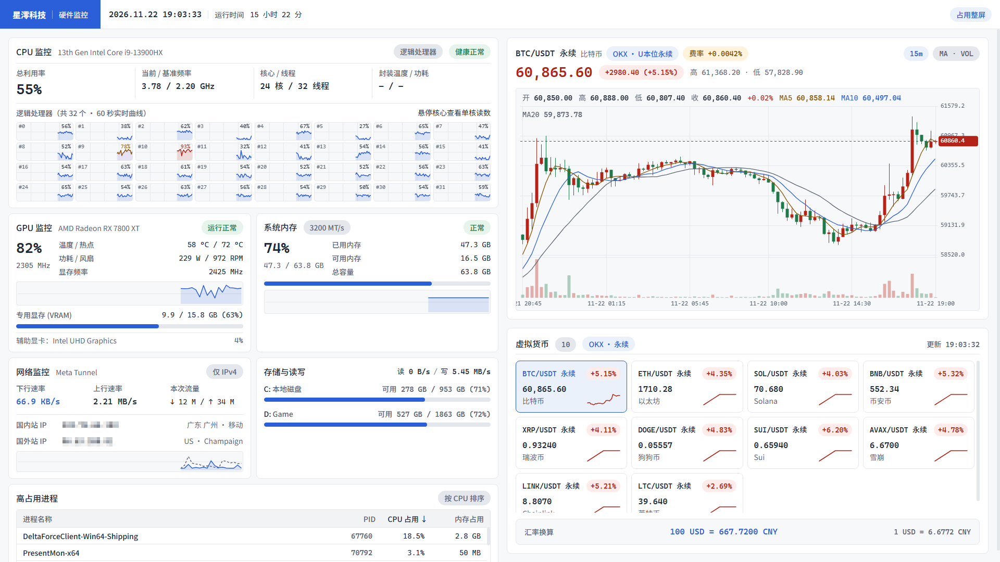
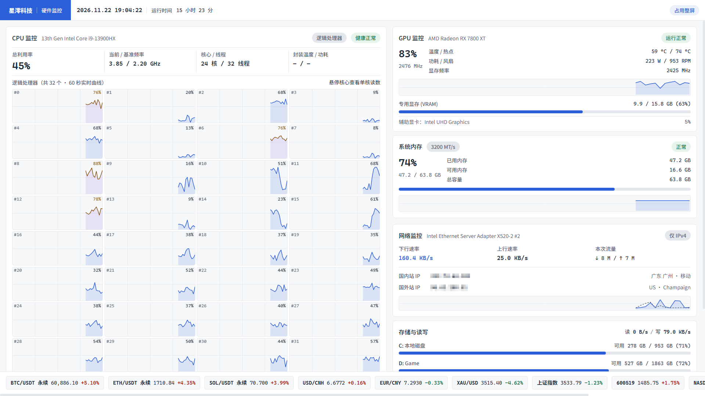
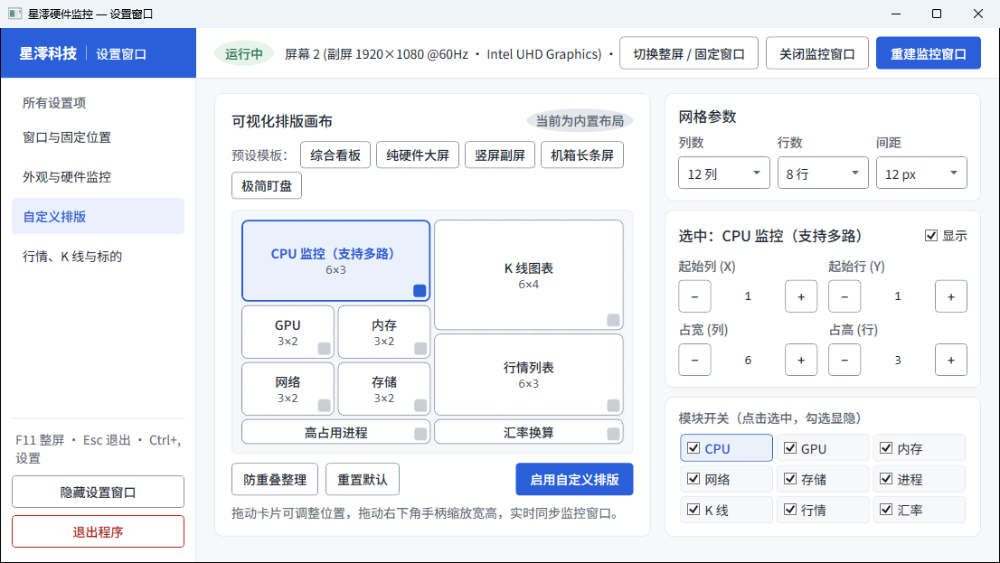
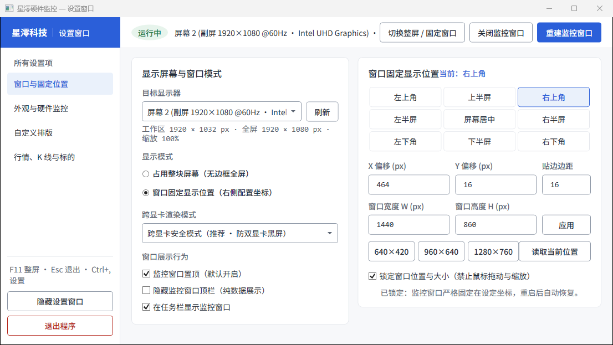

# MioHardwareMonitor

放在副屏或桌面角落的 Windows 硬件监控与行情看板，基于 .NET 10 (WPF) + WebView2。

主要解决几个日常痛点：把设置界面和监控画面拆成两个独立窗口，监控窗只留数据、不放按钮；支持多路 CPU、自定义排版编辑和托盘右键快捷控制；同时针对笔记本核显/独显混用、多屏外接场景做了跨显卡渲染和位置锁定，开着扔副屏就行。

## 实机界面预览

<table>
  <tr>
    <td></td>
    <td></td>
  </tr>
  <tr>
    <td align="center">综合看板 · 浅色主题（32 线程全核 + K 线）</td>
    <td align="center">综合看板 · 深色主题</td>
  </tr>
  <tr>
    <td></td>
    <td></td>
  </tr>
  <tr>
    <td align="center">性能专注模式（大尺寸全逻辑核心网格）</td>
    <td align="center">设置窗口 · 可视化自定义排版（拖动 / 缩放）</td>
  </tr>
</table>

<details>
<summary>展开查看：16:9 独立设置窗口（显示器投送与固定位置锁定）</summary>



</details>

## 下载与安装

在 [Releases](https://github.com/Klop233/MioHardwareMonitor/releases) 页面下载对应架构的包（每次推送 `main` 会通过 GitHub Actions 自动构建）：

| 架构 | 便携版（解压即用） | 安装包（支持快捷方式 / 开机自启） |
|---|---|---|
| Windows x64 | `SideScreenHUD-v*-win-x64.zip` | `SideScreenHUD-v*-win-x64-Setup.exe` |
| Windows ARM64 | `SideScreenHUD-v*-win-arm64.zip` | `SideScreenHUD-v*-win-arm64-Setup.exe` |

运行时已打包进程序内，不需要单独装 .NET Desktop Runtime，只要系统带 Microsoft Edge WebView2 即可（Win10/11 默认自带）。

> 如需读取 CPU 封装温度等底层传感器，可以在托盘菜单或设置窗口里点「以管理员身份重启」。

## 主要功能

### 窗口、多屏与自定义排版
- 监控窗口与设置窗口分离：设置窗为 16:9 横版，所有选项集中在设置窗或托盘右键菜单里调整，监控窗只负责展示数据。
- 两种显示模式：占满指定显示器，或固定在某个屏幕的指定像素坐标 / 停靠位置（9 种预设位置、自定义宽高、默认置顶和 Win32 级位置锁定，防止误拖）。
- 可视化自定义排版编辑器：在设置窗口的「自定义排版」页中可自由设置网格行列数与间距，直接拖动卡片调整位置、拖拽右下角手柄缩放宽高、单独开关 9 个监控模块，内置综合看板 / 纯硬件大屏 / 竖屏副屏 / 机箱长条屏 / 极简盯盘 5 套预设模板与一键防重叠整理，修改实时同步到监控窗口。
- 系统托盘快捷菜单：左键打开设置窗口，右键可直接切换屏幕、全屏/固定窗口、置顶、锁定、主题、布局、多路 CPU 显示、采样频率、K 线周期，也能直接查看并点击复制出口 IP。
- 跨显卡渲染兼容：针对笔记本异构双屏（核显屏 + 独显外接屏）可能出现的 WebView2 黑屏问题，提供安全模式 / 禁用 DComp / 原生 GPU 三种渲染切换。

### 硬件与网络监控
- CPU（支持单路与多路处理器）：默认像 Windows 任务管理器一样同屏显示所有逻辑处理器的 60 秒实时曲线，鼠标悬停可看单核当前/均值/峰值；在双路 / 多路 CPU 机器上可自动分路展示每颗物理 CPU 的核心曲线、频率、温度与功耗，也支持合并总览或单路聚焦。
- GPU / 内存 / 磁盘 / 进程：实时查看显卡占用、温度与热点、显存、风扇与频率，内存与磁盘读写/容量，以及按 CPU 或内存排序的高占用进程表。
- 网络与双出口 IP：网卡实时上下行速率与累计流量，同时检测并分开显示访问**国内站**和**国外站**的出口 IPv4 地址及归属地（默认忽略 IPv6）。

### 行情与界面
- 支持虚拟货币（Binance / OKX / Bybit / Bitget / Gate.io 永续与现货）、美股、A 股、外汇与大宗商品行情和 K 线（`1m` ~ `1W`、MA/BOLL/VOL、自定义标的）。
- 内置浅色 / 深色两套主题、综合 / 性能 / 行情 / 自定义四种视图布局，以及针对 OLED 副屏的防烧屏偏移选项。

## 快捷键

监控窗口聚焦时可用：

- `F11`：在「占用整屏」与「固定窗口」之间切换
- `Esc`：从整屏退回固定窗口
- `Ctrl + ,`：打开设置窗口
- `Ctrl + 1~9`：将监控窗口重建并投送到第 1~9 块显示器

## 从源码编译

环境要求：Windows 10/11、[.NET 10 SDK](https://dotnet.microsoft.com/)。

```powershell
# 直接编译并运行（或双击根目录 start.bat）
dotnet build -c Release
.\bin\Release\net10.0-windows\SideScreenHUD.exe
```

打包自包含 Release（`win-x64` / `win-arm64` 便携 ZIP；如果本机装了 Inno Setup 6，会顺带打出 `-Setup.exe` 安装包）：

```powershell
powershell -ExecutionPolicy Bypass -File scripts\build-release.ps1
```

## 依赖项目

- [LibreHardwareMonitor](https://github.com/LibreHardwareMonitor/LibreHardwareMonitor) — 硬件传感器采集
- [Microsoft Edge WebView2](https://developer.microsoft.com/en-us/microsoft-edge/webview2/) — 仪表盘前端渲染
- [Inno Setup](https://jrsoftware.org/isinfo.php) — Windows 安装包打包
